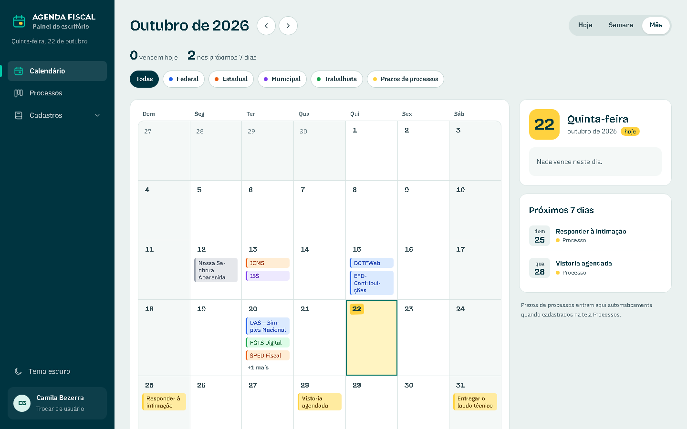
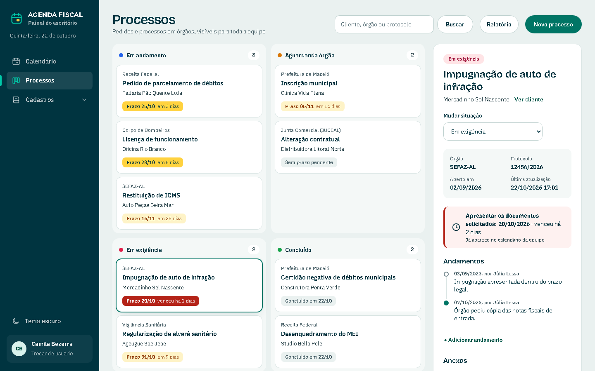
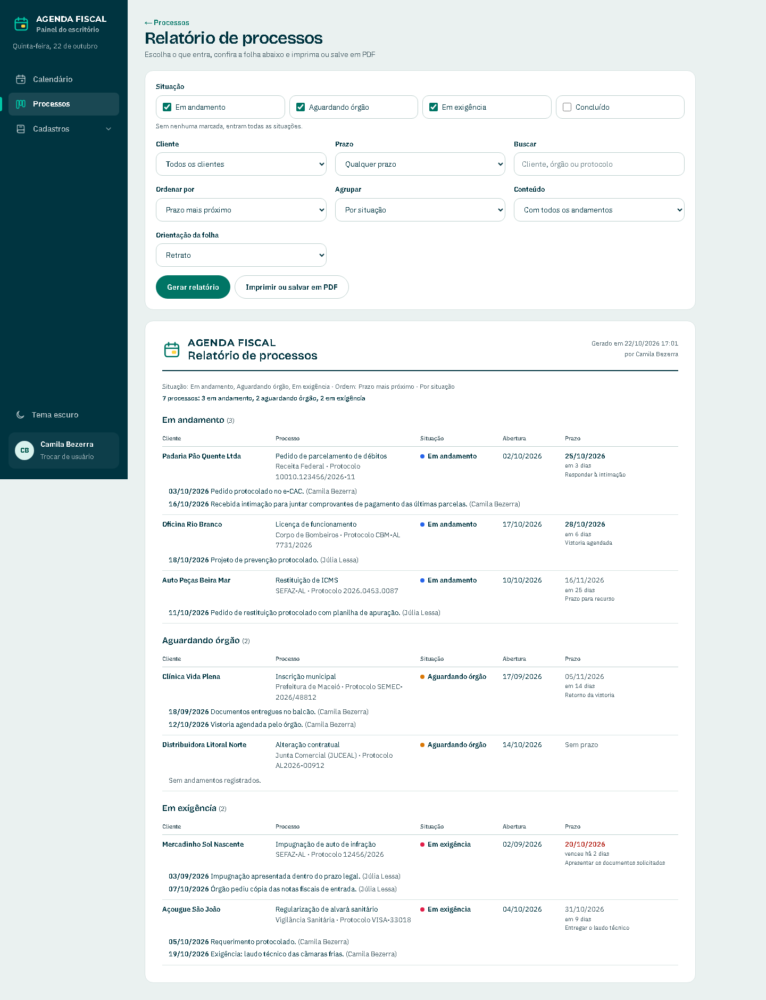
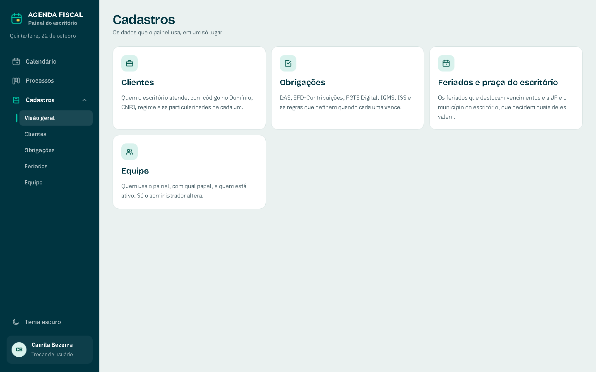
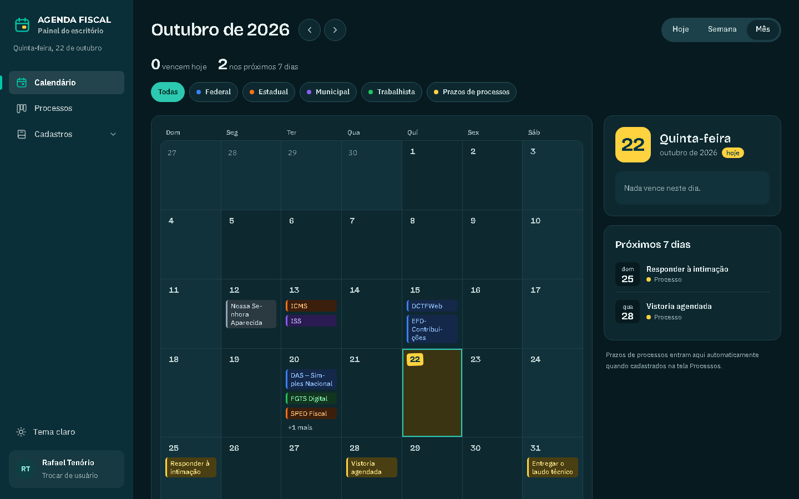
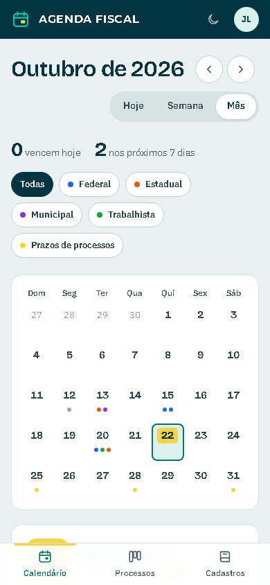
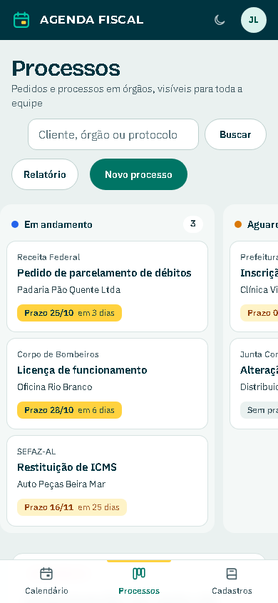

# Agenda Fiscal

Painel interno para um escritório de contabilidade: mostra **o que vence hoje, na semana e no mês** e
acompanha os **processos administrativos** em andamento (prefeitura, SEFAZ, Receita, Junta Comercial...),
com autoria e histórico em toda alteração.

Não é gestão de tarefas: é um painel de consulta e registro, pensado para a equipe abrir de manhã e ver,
sem planilha, o que precisa de atenção.



## Experimente em um minuto

```bash
npm install
npm run demo
```

Abra http://localhost:3000 e escolha uma pessoa da equipe. O modo demonstração sobe com **dados fictícios**
(clientes, obrigações e processos inventados, com datas em torno de hoje) num banco temporário que é apagado a
cada execução. Nada do seu banco real é tocado.

Requer Node 20.9 ou mais novo.

## O que ele faz

- **Calendário de vencimentos** em três visões (hoje, semana, mês), com filtro por esfera (federal, estadual,
  municipal, trabalhista) e os prazos dos processos no mesmo calendário. O vencimento é **calculado a partir de
  regras** (dia fixo, N-ésimo dia útil, antecipa ou posterga em fim de semana e feriado, competência defasada),
  não gravado mês a mês.
- **Feriados que deslocam vencimentos**: os nacionais, fixos e móveis (Carnaval, Sexta-feira Santa, Corpus
  Christi, a partir da Páscoa), valem em qualquer ano; os estaduais e municipais são cadastrados e só valem na
  praça do escritório.
- **Processos** em quadro por situação (em andamento, aguardando órgão, em exigência, concluído), com busca,
  linha do tempo de andamentos, anexos e selos de prazo (vencido, urgente, adiante).
- **Relatório de processos** para imprimir ou salvar em PDF, com filtros, ordem, agrupamento, andamentos e
  orientação do papel.
- **Cadastros**: clientes (com código no Domínio, regime e campo livre de particularidades), obrigações,
  feriados e equipe.
- **Equipe com papéis** (administrador e membro) e **identificação sem senha** nesta fase: toda escrita grava
  quem fez, e o histórico de cada registro é consultável. Exclusão é sempre lógica.
- **Tema claro e escuro**, lembrado por navegador, e layout pensado para celular (quadro vira carrossel, abas
  na base).

| | |
|---|---|
|  |  |
|  |  |

<p>
  
  
</p>

## Decisões técnicas

- **Next.js 16 (App Router) + React 19 + TypeScript**, com `cacheComponents`: toda tela que lê banco, cookie ou
  relógio fica atrás de `connection()` e `<Suspense>`. Mutações são **Server Actions** que devolvem
  `{ ok } | { erro }` em português, sem lançar para a tela.
- **PostgreSQL de verdade, sem servidor**: o banco é o [PGlite](https://pglite.dev) (Postgres em WASM), rodando
  no processo do Node. As migrations em `supabase/migrations/` são SQL padrão e já servem ao Supabase quando a
  hospedagem entrar, sem reescrita.
- **Uma só porta de escrita** (`lib/db/escrita.ts`): permissões por papel, colunas de auditoria, exclusão lógica
  e histórico (antes e depois de cada campo) acontecem no mesmo lugar, dentro de uma transação. Nenhuma tela monta
  SQL, e o SQL só existe em `lib/db/`.
- **Regras de negócio puras e testadas** (`lib/regras/`): dia útil, vencimentos, feriados aplicáveis à praça,
  feriados móveis pela Páscoa, prazos e filtros do relatório. Datas são texto `AAAA-MM-DD` e a aritmética é em
  UTC, para nunca depender do fuso da máquina (o fuso do escritório é America/Maceio).
- **Tailwind v4 com tokens de cor em variáveis CSS**: os dois temas são duas paletas da mesma lista de tokens, e
  a folha do relatório fixa a paleta clara para imprimir igual em qualquer tema. O quadro de processos usa
  *container queries*, porque o detalhe divide a linha com ele.
- **Testes** com Vitest: 150+ testes cobrindo regras, camada de banco (PGlite em memória) e Server Actions.

```bash
npm test            # suíte completa
npx tsc --noEmit    # tipos
npm run lint
```

## Estrutura

```
app/                 rotas (App Router): calendário, processos, cadastros, equipe, identificação
components/          componentes de interface (nunca importam de app/)
lib/regras/          regras de negócio puras (vencimentos, feriados, prazos, relatório)
lib/db/              todo o SQL, o helper de escrita e a conexão com o PGlite
supabase/migrations/ esquema do banco, pronto para o Supabase
scripts/demo.mjs     `npm run demo`
docs/                especificação e plano de implementação; capturas de tela em docs/img
referencia/          mockups que serviram de ponto de partida do layout
```

## Usando com dados reais (`npm run dev`)

Sem o modo demonstração, o banco começa com um administrador e os feriados nacionais fixos de 2026 e 2027. No
Windows os dados ficam em `%LOCALAPPDATA%\agenda-fiscal\pgdata` (fora do projeto: sincronizadores como o Google
Drive marcam pastas como somente leitura e o PGlite deixa de abrir o banco); em outros sistemas, em `pgdata/`. A
variável `AGENDA_FISCAL_DB` muda o local. Os anexos ficam em `arquivos/`. Nenhuma dessas pastas vai para o Git.

## Estado e próximos passos

Esta é a **fase local**: um processo, um banco, identificação por escolha de nome (sem senha), pensada para a rede
interna do escritório. O destino é Supabase (banco, login por e-mail e anexos) na Vercel. Isso pede trocar a
identificação por login real, mover os anexos para o Storage e ligar as políticas de acesso por linha, que já
estão escritas em `supabase/migrations/9999_rls.sql`.

## Licença

[MIT](LICENSE): use, copie e adapte à vontade. A identidade visual é própria e neutra, sem marca de cliente, e todos
os dados de exemplo são fictícios.
